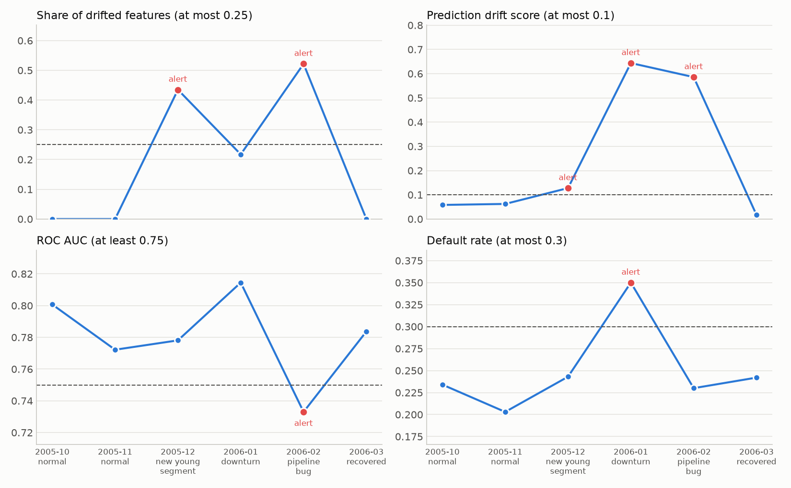
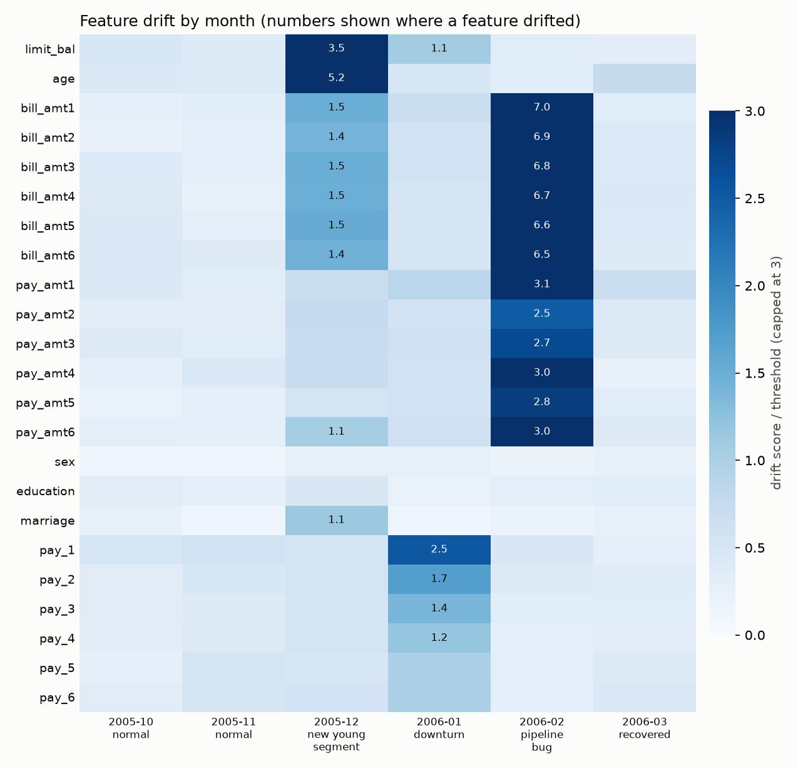
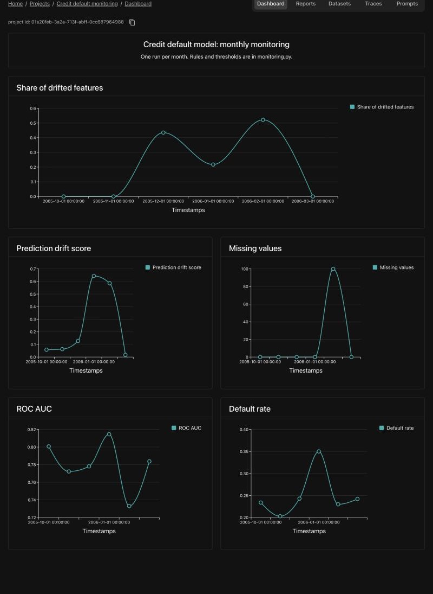

# Monitoring Lab: Data and Model Drift for a Credit Default Model with Evidently


A model that passed every check on launch day can still go wrong later: the clients change, the economy changes, or an upstream system starts sending broken data. Monitoring compares each new batch of production data with a reference period and raises an alert when something moved. This lab uses [Evidently](https://github.com/evidentlyai/evidently) to do that for the credit default model from my MLflow lab, over six simulated months that include three kinds of trouble.

It's based on the course's Evidently lab ([Labs/Data_Labs/Data_Monitoring/Evidently_AI](https://github.com/Het415/MLOps/tree/main/Labs/Data_Labs/Data_Monitoring/Evidently_AI)). The notebook is `evidently_monitoring.ipynb`; the checks themselves live in `monitoring.py` so CI and the command line can use them too.



## What I changed from the original lab

| | Original | This version |
|---|---|---|
| **Dataset** | Adult census income from OpenML (48,842 people) | UCI Default of Credit Card Clients (30,000 clients), the same data as my MLflow lab |
| **Model** | None; only input data is compared | The XGBoost champion from my MLflow lab, refit with the same settings. Monitoring reads its prediction logs (features, predicted probability, outcome) |
| **Reference vs current** | One split: people with "Some-college", "HS-grad" or "Bachelors" education as current, everyone else as reference | The validation period (6,000 clients with predictions and outcomes) as reference, six monthly batches of 1,000 clients as current |
| **Drift scenarios** | The education split | Two normal months, a new young customer segment, an economic downturn, a pipeline bug (amounts arrive in thousands, 10% of `education` missing), and a recovered month |
| **Reports** | One `DataDriftPreset` report shown inline (`DataSummaryPreset` is imported but unused) | The same kind of inline report first, then a report for every month with `DataDriftPreset`, `ClassificationPreset` and five metrics with tests, saved as HTML |
| **Alerting** | None | Five rules built from Evidently tests: share of drifted features, prediction drift, missing values, ROC AUC, default rate |
| **Label delay** | Not considered | Checks run with and without the outcomes, to show what can be caught on the day predictions are made |
| **Dashboard** | An Evidently Cloud workspace created with a hard-coded API token and never used | A local Evidently workspace with one run per month and a dashboard of the five rules, opened with `evidently ui`. No account needed |
| **Reusable checks** | Notebook only | `monitoring.py`, used by the notebook and as a command line gate that exits with status 1 on an alert |
| **Results tracking** | Notebook output only | `results/metrics.json`, two charts, a dashboard screenshot, and the prediction logs |
| **CI** | None | GitHub Actions runs the notebook, checks that each scenario raises the expected alerts, gates on the latest month, and uploads the HTML reports and the workspace |
| **Environment** | `evidently==0.7.0` in a commented-out install line, Python 3.10 | Pinned versions on Python 3.12, telemetry turned off with `DO_NOT_TRACK=1` |

### Things worth knowing

- **Drift is not decay.** The downturn barely moved the inputs (5 of 23 features) but shifted the predictions more than any other month and pushed the default rate to 35%, while AUC went *up*. The new segment moved 10 features but kept AUC at 0.7781. Only the pipeline bug actually hurt the model.
- **The preset's default is loose.** `DataDriftPreset` only calls it dataset drift when half the columns drift, so the new segment (43% of features) wouldn't count. My feature drift rule uses 25%.
- **Missing values hide from drift checks.** `education` didn't drift in the bug month even with 10% of it missing, because drift is measured on the values that are there. Missing values need their own rule.
- **Prediction drift is the early warning.** It needs no outcomes, and it fired in all three problem months.
- **Two Evidently 0.7.23 gotchas.** It fails to import with pandas 3 (it uses a private pandas function that pandas 3 removed), so pandas is pinned to 2.3.3. And `ClassificationPreset(include_tests=False)` crashes; leaving the flag out works, since preset tests only run with `Report(include_tests=True)`.
- **Telemetry.** Evidently sends anonymous usage statistics unless `DO_NOT_TRACK` is set. The notebook, `monitoring.py` and CI all set it.

## Dataset and scenarios

- **Source:** [Default of Credit Card Clients](https://archive.ics.uci.edu/dataset/350/default+of+credit+card+clients), UCI Machine Learning Repository, [doi:10.24432/C55S3H](https://doi.org/10.24432/C55S3H). Yeh, I. C., and Lien, C. H. (2009), Expert Systems with Applications 36(2).
- **License:** [CC BY 4.0](https://creativecommons.org/licenses/by/4.0/).
- **File:** `data/credit_default.csv`, the same cleaned CSV as my MLflow lab: 30,000 clients, 23 features, 22.1% default.

Same splits and seed as the MLflow lab (60/20/20, stratified, seed 123). The model trains on the 18,000 training clients. The 6,000 validation clients with predictions and outcomes are the reference (default rate 0.2212). The 6,000 held-out clients are the pool the production months are drawn from.

The dataset has no dates, so the months are simulated. Five of the six months are real clients with their real outcomes (the segment and downturn months only change who is likely to be picked). Only the bug month changes values.

| Month | Scenario | How it's built |
|---|---|---|
| 2005-10 | normal | random 1,000 clients |
| 2005-11 | normal | random 1,000 clients |
| 2005-12 | new young segment | clients under 30 with a limit of 100,000 or less are 7 times as likely to be picked |
| 2006-01 | downturn | clients who were late last month (`pay_1` of 1 or more) are 6 times as likely to be picked |
| 2006-02 | pipeline bug | random clients, then the 12 bill and payment amounts divided by 1,000 and `education` blanked for 10% of rows |
| 2006-03 | recovered | random 1,000 clients |

## Alert rules

Defined in `monitoring.py` as Evidently metrics with tests attached.

| Rule | Evidently metric | Alert when | Needs outcomes |
|---|---|---|---|
| `drifted_feature_share` | `DriftedColumnsCount` | more than 25% of the 23 features drift | no |
| `prediction_drift` | `ValueDrift` on `prediction` | drift score (normed Wasserstein distance) above 0.1 | no |
| `missing_values` | `DatasetMissingValueCount` | any value is missing | no |
| `roc_auc` | `RocAuc` | AUC below 0.75, the same floor as the MLflow lab's CI gate | yes |
| `default_rate` | `MeanValue` on `default` | more than 30% of clients default | yes |

## Results

All numbers are from `results/metrics.json`.

The refit model scores a validation AUC of 0.7781 and 0.7835 on the held-out pool, with 346 boosting rounds (the MLflow lab's champion: 0.7784 and 0.7837; the small gap comes from the settings being rounded to 4 decimals).

### Monthly checks

| Month | Scenario | Drifted features | Drifted share | Prediction drift | Missing values | ROC AUC | Default rate | Mean prediction | Alerts |
|---|---|---|---|---|---|---|---|---|---|
| 2005-10 | normal | 0 | 0.0000 | 0.0582 | 0 | 0.8007 | 0.2340 | 0.2321 | none |
| 2005-11 | normal | 0 | 0.0000 | 0.0623 | 0 | 0.7722 | 0.2030 | 0.2109 | none |
| 2005-12 | new young segment | 10 | 0.4348 | 0.1277 | 0 | 0.7781 | 0.2430 | 0.2461 | `drifted_feature_share`, `prediction_drift` |
| 2006-01 | downturn | 5 | 0.2174 | 0.6438 | 0 | 0.8145 | 0.3500 | 0.3472 | `prediction_drift`, `default_rate` |
| 2006-02 | pipeline bug | 12 | 0.5217 | 0.5858 | 100 | 0.7330 | 0.2300 | 0.3056 | `drifted_feature_share`, `prediction_drift`, `missing_values`, `roc_auc` |
| 2006-03 | recovered | 0 | 0.0000 | 0.0169 | 0 | 0.7837 | 0.2420 | 0.2228 | none |

Features that drifted:

| Month | Drifted features |
|---|---|
| 2005-12 | `limit_bal`, `age`, `bill_amt1` to `bill_amt6`, `pay_amt6`, `marriage` |
| 2006-01 | `limit_bal`, `pay_1`, `pay_2`, `pay_3`, `pay_4` |
| 2006-02 | `bill_amt1` to `bill_amt6`, `pay_amt1` to `pay_amt6` |



### Before the outcomes arrive

| Month | Alerts without outcomes | Alerts with outcomes |
|---|---|---|
| 2005-10 | none | none |
| 2005-11 | none | none |
| 2005-12 | `drifted_feature_share`, `prediction_drift` | `drifted_feature_share`, `prediction_drift` |
| 2006-01 | `prediction_drift` | `prediction_drift`, `default_rate` |
| 2006-02 | `drifted_feature_share`, `prediction_drift`, `missing_values` | `drifted_feature_share`, `prediction_drift`, `missing_values`, `roc_auc` |
| 2006-03 | none | none |

Every problem month is caught before the outcomes are known; the outcomes only add the default-rate and AUC alerts.

### Evidently dashboard

The local workspace in the Evidently UI, one point per month:



### Command line gate

| Command | Exit code |
|---|---|
| `python monitoring.py prediction_logs/2005-11.csv` | 0 |
| `python monitoring.py prediction_logs/2006-02.csv` | 1 |
| `python monitoring.py prediction_logs/2006-01.csv --no-labels` | 1 |

## How to run

Tested on Python 3.12.

```bash
python3.12 -m venv .venv
```

```bash
source .venv/bin/activate
```

```bash
pip install -r requirements.txt
```

```bash
jupyter notebook evidently_monitoring.ipynb
```

Or run it end to end:

```bash
DO_NOT_TRACK=1 jupyter nbconvert --to notebook --execute --inplace evidently_monitoring.ipynb
```

The notebook writes the monthly HTML reports to `reports/` and the Evidently workspace to `workspace/` (both git-ignored; CI uploads them as the `monitoring-results` artifact). To open the dashboard:

```bash
DO_NOT_TRACK=1 evidently ui --workspace workspace --port 8000
```

and go to http://127.0.0.1:8000. To check a single batch from the command line (the prediction logs are committed, so this works straight after cloning):

```bash
python monitoring.py prediction_logs/2006-02.csv --report reports/2006-02.html
```

Add `--no-labels` to run only the three checks that don't need outcomes.

## Project structure

```
.
├── evidently_monitoring.ipynb        # the lab: model, scenarios, reports, rules, dashboard, gate
├── monitoring.py                     # data definition, alert rules and the command line gate
├── data/
│   └── credit_default.csv            # UCI Default of Credit Card Clients as CSV
├── prediction_logs/
│   ├── reference.csv                 # validation period with predictions and outcomes
│   └── 2005-10.csv ... 2006-03.csv   # the six simulated months
├── results/
│   ├── metrics.json                  # every key number from the notebook
│   ├── monitoring_over_time.png      # the rule metrics by month, with alerts marked
│   ├── drift_heatmap.png             # drift score per feature and month
│   └── evidently_dashboard.jpg       # screenshot of the local Evidently dashboard
├── requirements.txt                  # pinned dependencies for Python 3.12
├── .github/workflows/monitoring.yml  # CI: notebook, scenario checks, gate, artifacts, summary
└── README.md
```
